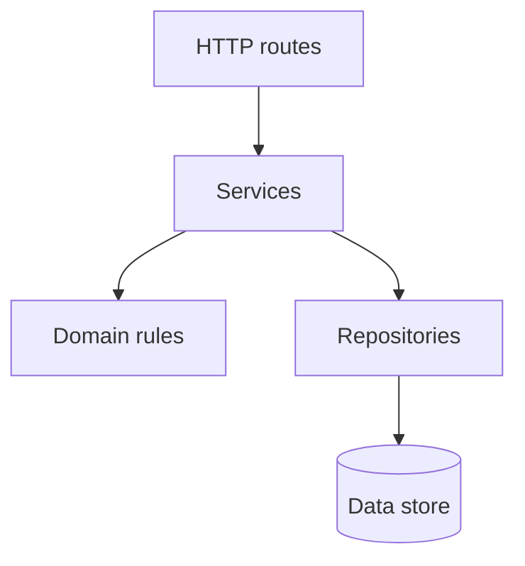
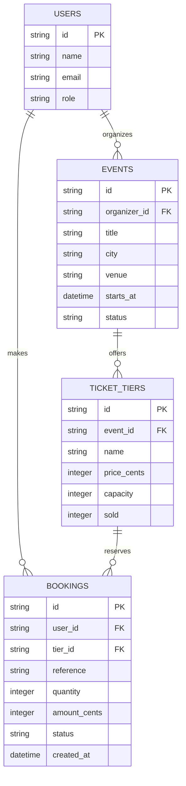
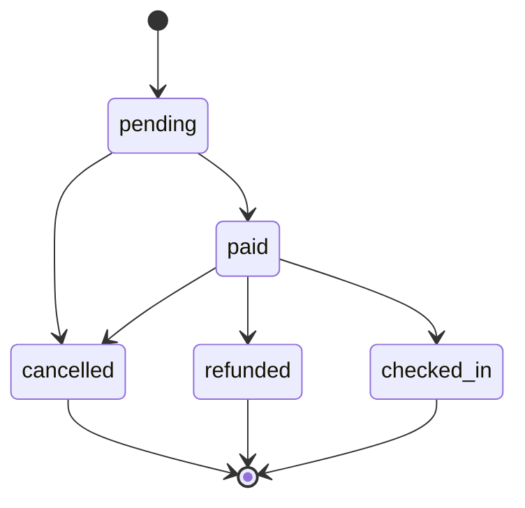

# Build 3 architecture

## Layers

- **Routes** may translate HTTP requests and responses; they may not contain business rules or access data directly.
- **Services** may coordinate domain rules and repositories; they may not depend on HTTP details or call routes.
- **Domain rules** may validate and apply business rules; they may not perform I/O or depend on services, repositories, or routes.
- **Repositories** may read and write data; they may not make business decisions or call services, rules, or routes.
- **Data store** holds persisted data; it may not call application layers.

## Data model

## Booking life cycle

